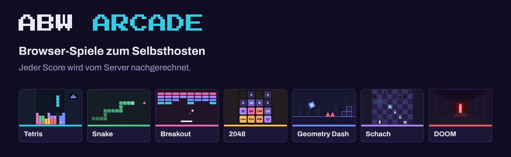
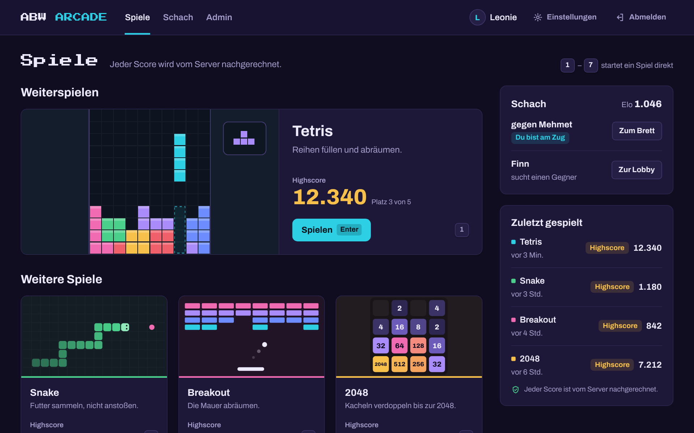
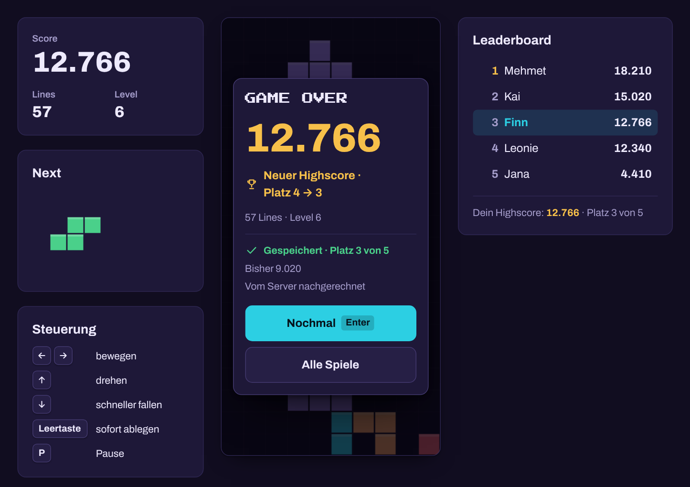
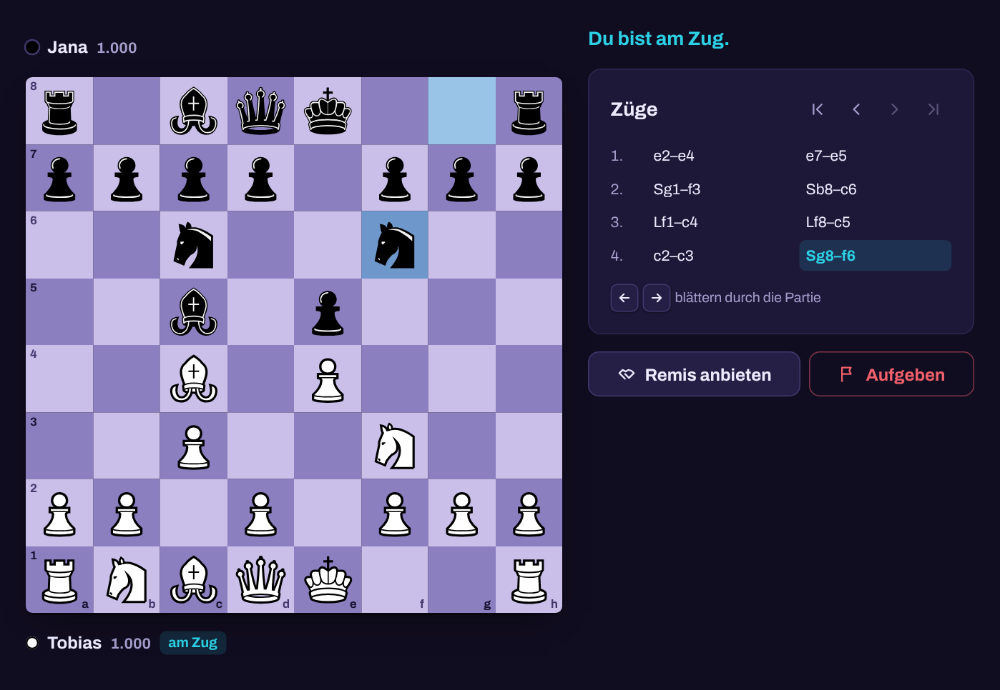
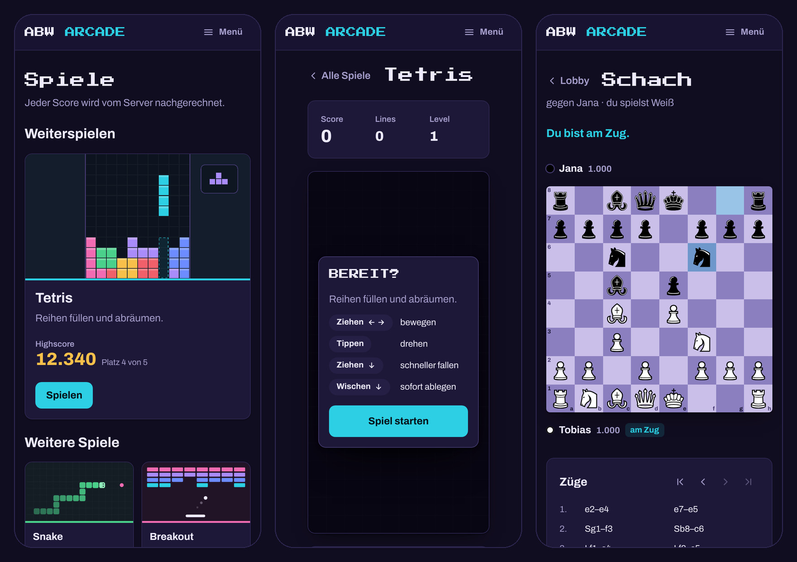

# ABW Arcade



ABW Arcade ist eine Sammlung von Browser-Spielen zum Selbsthosten. Jeder Score
wird vom Server nachgerechnet, bevor er ins Leaderboard kommt. Die Anwendung
läuft als Dienst im eigenen Netz, ohne Werbung, Tracking oder externe Dienste.

[](https://github.com/utmwzar/ABW-Arcade/actions/workflows/ci.yml)

**[Installieren](#schnellstart) · [Spiele](#spiele-und-technik) · [Mitentwickeln](#mitentwickeln) · [Changelog](CHANGELOG.md)**

## So sieht es aus



<table>
<tr>
<td width="50%"></td>
<td width="50%"></td>
</tr>
</table>



Namen und Spielstände in den Bildern sind ausgedacht.

## Funktionen

- Tetris, Snake, Breakout, 2048 und Geometry Dash mit Leaderboard. Der
  Server spielt jede Partie nach, ein gefälschter Score wird nicht
  angenommen.
- Schach gegen andere Spieler mit Elo-Wertung oder gegen einen Bot in drei
  Stärken. Jede Partie lässt sich Zug für Zug nachspielen.
- DOOM mit den freien Spieldaten von FreeDoom, direkt im Browser.
- Eine Übersicht wie in einer Spielebibliothek, mit dem zuletzt gespielten
  Spiel, Highscore und Platz je Spiel und offenen Schachpartien.
- Bedienung mit Tastatur und Maus am Desktop und mit Gesten auf Handy und
  Tablet.
- Ein Admin-Bereich für Accounts und Scores.
- Läuft als Dienst unter Linux, macOS und Windows, gebaut mit Flask, SQLite
  und waitress. Es braucht keinen Datenbankserver, keinen Reverse Proxy,
  kein Docker und keine externen Dienste.

## Schnellstart

Unter Linux (Debian, Ubuntu) und macOS im Terminal mit Administratorrechten:

```bash
curl -fsSL -o abw-arcade.tar.gz \
  https://github.com/utmwzar/ABW-Arcade/releases/latest/download/abw-arcade.tar.gz
tar -xzf abw-arcade.tar.gz && cd abw-arcade && sudo ./install.sh
```

Unter Windows 10 und 11
[`abw-arcade.zip`](https://github.com/utmwzar/ABW-Arcade/releases/latest/download/abw-arcade.zip)
herunterladen, in den Eigenschaften der Datei *Zulassen* ankreuzen, entpacken
und `install.cmd` doppelklicken.

Danach die Seite im Browser öffnen (Port 5000, unter macOS 5050), einen
Account registrieren und den [ersten Admin ernennen](#ersten-admin-ernennen).
Voraussetzungen und Einzelheiten je System stehen unter
[Installation](#installation).

---

## Installation

ABW Arcade läuft als Dienst, der beim Hochfahren von selbst startet und im
lokalen Netz erreichbar ist. Für jedes System gibt es ein
Installationsskript. Es braucht Administratorrechte und eine
Internetverbindung für die Python-Pakete; alles Weitere richtet es selbst
ein.

Die Download-Links zeigen immer auf das neueste Release. Das `.tar.gz` ist
für Linux und macOS, das `.zip` für Windows; der Inhalt ist derselbe.

Unter Linux läuft ABW Arcade seit dem ersten Release. Die Installation unter
macOS und Windows ist bisher in der CI auf den Testmaschinen von GitHub
geprüft. Erfahrungen von anderen Rechnern sind als
[Issue](https://github.com/utmwzar/ABW-Arcade/issues) willkommen.

### Linux (Debian, Ubuntu)

Vorausgesetzt wird Debian oder Ubuntu (LXC, VM oder Container) mit
Root-Zugang.

```bash
curl -fsSL -o abw-arcade.tar.gz \
  https://github.com/utmwzar/ABW-Arcade/releases/latest/download/abw-arcade.tar.gz
tar -xzf abw-arcade.tar.gz
cd abw-arcade
sudo ./install.sh
```

Wo `curl` fehlt, tut `wget -O abw-arcade.tar.gz <URL>` dasselbe.

Danach läuft die Seite auf Port **5000**. Einen anderen Port setzt
`sudo ./install.sh --port 8080`. Als Umgebungsvariable (`PORT=8080`) kommt
der Port nur in einer Root-Shell an, weil `sudo` Umgebungsvariablen
verwirft.

### macOS

Vorausgesetzt werden ein Administratorkonto und Python 3.10 oder neuer, für
alle Benutzer installiert. Am einfachsten ist der *macOS 64-bit universal2
installer* von [python.org](https://www.python.org/downloads/macos/); ein
Python aus Homebrew geht ebenfalls. Das Python von macOS selbst
(`/usr/bin/python3`) eignet sich nicht, ebenso wenig eines in einem
Benutzerordner, denn der Dienst läuft unter einem eigenen Konto und darf
dort nicht lesen.

```bash
curl -fsSL -o abw-arcade.tar.gz \
  https://github.com/utmwzar/ABW-Arcade/releases/latest/download/abw-arcade.tar.gz
tar -xzf abw-arcade.tar.gz
cd abw-arcade
sudo ./install.sh
```

Danach läuft die Seite auf Port **5050**, weil ab macOS 12 meist der
AirPlay-Empfänger Port 5000 belegt. Ein anderer Port geht wie unter Linux
über `sudo ./install.sh --port 8080`. Findet das Skript kein passendes
Python, sagt es, was zu tun ist; ein bestimmtes lässt sich mit
`--python /pfad/zu/python3` vorgeben.

### Windows

Vorausgesetzt wird Windows 10 oder 11 mit Administratorrechten. Python 3.10
oder neuer muss für alle Benutzer installiert sein; fehlt es, bietet das
Skript an, es über `winget` einzurichten. Wer Python selbst installiert,
wählt im Installer von [python.org](https://www.python.org/downloads/windows/)
*Customize installation* und kreuzt *Install Python for all users* an. Das
Python aus dem Microsoft Store funktioniert nicht.

1. [`abw-arcade.zip`](https://github.com/utmwzar/ABW-Arcade/releases/latest/download/abw-arcade.zip)
   herunterladen.
2. Rechtsklick auf die Datei → *Eigenschaften* → unten bei *Sicherheit*
   *Zulassen* ankreuzen. Sonst behandelt Windows jede Datei daraus als
   Download aus dem Internet und warnt bei jedem Skript.
3. Rechtsklick → *Alle extrahieren …*. Dabei entsteht ein Ordner
   `abw-arcade` mit einem gleichnamigen Ordner darin; `install.cmd` liegt im
   inneren.
4. `install.cmd` doppelklicken und die Rückfrage nach Administratorrechten
   bestätigen. Erscheint stattdessen *Der Computer wurde durch Windows
   geschützt*, über *Weitere Informationen* → *Trotzdem ausführen* starten.

Dasselbe in einer PowerShell:

```powershell
Invoke-WebRequest -OutFile abw-arcade.zip `
  -Uri https://github.com/utmwzar/ABW-Arcade/releases/latest/download/abw-arcade.zip
Unblock-File abw-arcade.zip
Expand-Archive abw-arcade.zip -DestinationPath .
.\abw-arcade\install.cmd
```

Danach läuft die Seite auf Port **5000**. Ein anderer Port geht über
`install.cmd -Port 8080`. Das Fenster bleibt am Ende offen, bis Enter
gedrückt wird. Dort stehen die Adresse der Seite und der Befehl für den
ersten Admin.

### Alternative: direkt aus git

Die Skripte laufen auch in einem Klon des Repositorys:

```bash
git clone --depth 1 https://github.com/utmwzar/ABW-Arcade.git
cd ABW-Arcade
sudo ./install.sh            # Linux, macOS; unter Windows: install.cmd
```

Ein Release ist ein fester, getesteter Stand, der Klon dagegen der aktuelle
Entwicklungsstand. Für einen Server im Dauerbetrieb ist das Release die
bessere Wahl.

### Was die Skripte tun

Alle drei kopieren die Anwendung in einen festen Ordner, bauen dort ein
Python-Virtualenv, schreiben den Port in `arcade.conf` und richten einen
Dienst ein, der unter einem eigenen Konto ohne Anmeldung läuft. Zum Schluss
prüfen sie, ob die Seite antwortet und JavaScript richtig ausliefert.

| | Linux | macOS | Windows |
|---|---|---|---|
| Programm | `/opt/arcade` | `/opt/arcade` | `C:\ProgramData\ABW-Arcade` |
| Accounts, Scores | `/opt/arcade` | `/opt/arcade/data` | `C:\ProgramData\ABW-Arcade\data` |
| Dienst | `arcade.service` (systemd) | LaunchDaemon `io.github.utmwzar.abw-arcade` | Windows-Dienst „ABW Arcade“ (`abw-arcade`, über [WinSW](https://github.com/winsw/winsw)) |
| Konto | `arcade` | `_arcade` (versteckt) | `NT SERVICE\abw-arcade` |
| Logs | `journalctl -u arcade` | `/opt/arcade/logs/arcade.log` | `C:\ProgramData\ABW-Arcade\logs` |

Unter Linux installiert `install.sh` dazu `python3`, `python3-venv` und
`python3-pip` per `apt`. Unter macOS und Windows darf das Dienstkonto den
Programmordner nur lesen; schreiben kann es nur in `data` und `logs`.

Die Datenbank `arcade.db` entsteht beim ersten Start leer. Accounts oder
Scores werden nie mitgeliefert.

Am Ende meldet das Skript, welcher Stand installiert wurde. Dieselbe Angabe
steht danach in `PAKET-INFO` im Programmordner. So lässt sich auf einem
laufenden Server jederzeit feststellen, welcher Commit dort läuft.

### Ersten Admin ernennen

Zuerst im Browser registrieren, dann auf dem Server:

```bash
# Linux
cd /opt/arcade && sudo -u arcade .venv/bin/python run.py make-admin BENUTZERNAME

# macOS
sudo -u _arcade /opt/arcade/.venv/bin/python /opt/arcade/run.py make-admin BENUTZERNAME
```

```powershell
# Windows, in einer PowerShell als Administrator
& "C:\ProgramData\ABW-Arcade\.venv\Scripts\python.exe" "C:\ProgramData\ABW-Arcade\run.py" make-admin BENUTZERNAME
```

Wichtig sind `run.py` und das jeweilige Konto. `run.py` liest `arcade.conf`
und trifft damit dieselbe Datenbank wie der Dienst. Unter Linux und macOS
gehörten neu angelegte Dateien sonst `root`, und der Dienst könnte sie nicht
mehr schreiben; `run.py` warnt in diesem Fall.

### Firewall

- **Linux:** Ist `ufw` aktiv, den Port freigeben: `sudo ufw allow 5000/tcp`.
- **macOS:** Ist die Firewall eingeschaltet, trägt `install.sh` Python als
  erlaubtes Programm ein. Steht sie auf *Alle eingehenden Verbindungen
  blockieren*, hilft das nicht.
- **Windows:** `install.cmd` legt die Regel `ABW-Arcade-HTTP` für den Port an,
  gültig in privaten und Domänen-Netzwerken. Ist das Netzwerk als
  *Öffentlich* eingestuft, bleibt die Seite von außen gesperrt. Dann das
  Netzwerk in den Windows-Einstellungen auf *Privat* stellen oder
  `install.cmd -AllowPublic` verwenden.

---

## Update

Für ein Update das neue Paket herunterladen, entpacken und das Skript erneut
starten, wie bei der Installation. Was sich geändert hat, steht im
[Changelog](CHANGELOG.md). Die Skripte sind idempotent und lassen sich
beliebig oft ausführen.

Port, Accounts und Leaderboards bleiben erhalten. Ohne `--port` bzw. `-Port`
gilt der Port aus `arcade.conf`. Bei einer Linux-Installation von Version
1.0, die noch keine `arcade.conf` hat, übernimmt `install.sh` den Port aus
der bisherigen Dienstdatei.

Unangetastet bleiben:

| | |
|---|---|
| `arcade.db` | Accounts, Scores, Elo, laufende Partien |
| `secret_key` | Sitzungsschlüssel; ohne ihn müssen sich alle neu anmelden |
| `arcade.conf` | Port, Threads, Datenordner |
| `static/doom/doom1.wad`, `doom2.wad` | selbst hinterlegte DOOM-Daten, in jeder Schreibweise (`DOOM1.WAD`) |
| `.venv/` | das Virtualenv |
| `data/`, `logs/`, `service/` | Daten, Logs und Dienstprogramm unter macOS und Windows |

Alles andere wird ersetzt, überzählige Dateien werden entfernt. Welche
Dateien genau geschützt sind, steht in `installer/sync.py`; alle drei Skripte
kopieren damit.

### Zurücksetzen

Um alle Accounts und Scores zu löschen, den Dienst anhalten, `arcade.db` und
`secret_key` löschen und den Dienst wieder starten. Beide Dateien entstehen
beim nächsten Start neu.

```bash
# Linux
sudo systemctl stop arcade
sudo rm -f /opt/arcade/arcade.db /opt/arcade/secret_key
sudo systemctl start arcade

# macOS
sudo launchctl bootout system/io.github.utmwzar.abw-arcade
sudo rm -f /opt/arcade/data/arcade.db /opt/arcade/data/secret_key
sudo launchctl bootstrap system /Library/LaunchDaemons/io.github.utmwzar.abw-arcade.plist
```

```powershell
# Windows, PowerShell als Administrator
Stop-Service abw-arcade
Remove-Item C:\ProgramData\ABW-Arcade\data\arcade.db, C:\ProgramData\ABW-Arcade\data\secret_key
Start-Service abw-arcade
```

### Deinstallieren

Unter Windows erledigt das `install.cmd -Uninstall`: Dienst, Firewall-Regel
und Programm werden entfernt, `data\` und `arcade.conf` bleiben für eine
spätere Neuinstallation liegen. `install.cmd -Uninstall -RemoveData` entfernt
alles.

Unter Linux und macOS geht es von Hand; dabei werden auch alle Accounts und
Scores gelöscht:

```bash
# Linux
sudo systemctl disable --now arcade
sudo rm -f /etc/systemd/system/arcade.service
sudo systemctl daemon-reload
sudo rm -rf /opt/arcade
sudo userdel arcade

# macOS
sudo launchctl bootout system/io.github.utmwzar.abw-arcade
sudo rm -f /Library/LaunchDaemons/io.github.utmwzar.abw-arcade.plist
sudo rm -rf /opt/arcade
sudo dscl . -delete /Users/_arcade
sudo dscl . -delete /Groups/_arcade
```

---

## Betrieb

**Linux**

```bash
systemctl status arcade        # läuft es?
systemctl restart arcade       # neu starten
journalctl -u arcade -f        # Logs mitlesen
curl localhost:5000/healthz    # {"ok": true}
```

**macOS**

```bash
sudo launchctl print system/io.github.utmwzar.abw-arcade | grep state   # läuft es?
sudo launchctl kickstart -k system/io.github.utmwzar.abw-arcade         # neu starten
sudo tail -f /opt/arcade/logs/arcade.log                                # Logs mitlesen
curl localhost:5050/healthz                                             # {"ok": true}
```

**Windows** (PowerShell als Administrator)

```powershell
Get-Service abw-arcade                                    # läuft es?
Restart-Service abw-arcade                                # neu starten
Get-Content C:\ProgramData\ABW-Arcade\logs\abw-arcade.err.log -Tail 50 -Wait   # Logs mitlesen
curl.exe http://localhost:5000/healthz                    # {"ok": true}
```

In Windows PowerShell ist `curl` nur ein anderer Name für
`Invoke-WebRequest`, deshalb steht dort ausdrücklich `curl.exe`. Die
Ausgaben der Anwendung stehen in `abw-arcade.err.log`, die des
Dienstprogramms in `abw-arcade.wrapper.log`.

`/healthz` braucht keine Anmeldung und prüft auch die Datenbank. Die Adresse
eignet sich damit als Ziel für Uptime Kuma oder ein anderes Monitoring.

### Einstellungen

Port, Threads und Datenordner stehen in `arcade.conf` im Programmordner
(`PORT=…`, `THREADS=…`, `HOST=…`, `DATA_DIR=…`). Nach einer Änderung den
Dienst neu starten. Einen anderen Port setzt am besten das
Installationsskript (`--port` bzw. `-Port`), denn unter Windows passt es
dabei auch die Firewall-Regel an.

Was tatsächlich gilt und ob der Port frei ist, zeigt `run.py check`, unter
Linux etwa mit `sudo -u arcade /opt/arcade/.venv/bin/python /opt/arcade/run.py check`.
Ist der Port belegt, startet der Dienst nicht und meldet im Log „Port … ist
belegt oder reserviert“; unter Linux versucht systemd es dann nicht endlos
weiter.

Wo kein systemd läuft (etwa in einem Docker-Container), schreibt
`install.sh` die Dienstdatei trotzdem und gibt den passenden Startbefehl
aus.

---

## Spiele und Technik

### Leaderboards ohne Vertrauen in den Browser

Bei Tetris, Snake, Breakout, 2048 und Geometry Dash schickt der Browser nie
einen Score. Stattdessen:

1. Der Server vergibt pro Partie einen Zufalls-Seed und eine einmalige
   `game_id`.
2. Der Browser spielt daraus eine vollständig deterministische Partie und
   zeichnet nur die Eingaben auf (`{tick, action}`).
3. Nach Spielende schickt er Seed, `game_id` und das Eingabeprotokoll.
4. Der Server spielt die Partie mit derselben Engine nach und rechnet den
   Score selbst aus.

Ein gefälschter Score bräuchte also ein Eingabeprotokoll, das ihn
tatsächlich erreicht, und damit eine echte Partie auf diesem Niveau oder
einen Bot, der sie spielt.

Dafür müssen beide Fassungen jeder Engine exakt gleich rechnen, also
`tetris_engine.py` und `static/tetris_engine.js` ebenso wie die übrigen
Paare. Breakout und Geometry Dash rechnen ihre Physik deshalb in
Festkomma-Arithmetik mit Ganzzahlen statt mit Fließkommazahlen, und 2048
setzt neue Kacheln anhand des Seeds. Auch das Level von Geometry Dash
entsteht allein aus dem Seed; der Score ist die erreichte Distance.

Ob die Paare übereinstimmen, prüft ein eigener Test, siehe
[Gleichlauf der Engines prüfen](#gleichlauf-der-engines-prüfen).

Touch-Gesten und die Effekte im Spielfeld ändern daran nichts. Eine Geste
erzeugt dieselben Aktionen wie die Tasten und wird genauso aufgezeichnet
(`static/js/touch.js`). Die Effekte lesen die Engine nur und haben eine
eigene Uhr (`static/js/observe/`, `static/js/fx-canvas.js`). Ein Test spielt
jedes Spiel mit und ohne sie und verlangt dasselbe Ergebnis.

### Schach

Partien zwischen zwei Spielern laufen über die Lobby unter `/games/chess`:
Ein Account erstellt eine Partie, ein zweiter tritt bei. Nachgespielt wird
hier nichts, stattdessen prüft der Server jeden einzelnen Zug.
`chess_engine.py` kennt die vollständigen Regeln mit Rochade, en passant,
Umwandlung, Matt, Patt, 50-Züge-Regel, Stellungswiederholung und
ungenügendem Material. Die Zuggenerierung ist gegen Perft-Referenzwerte
abgeglichen.

Dazu kommen eine Elo-Wertung (K = 32, Startwert 1000), Remisangebote und
Aufgeben. Partien gegen den Bot (`chess_bot.py`, Negamax mit
Alpha-Beta-Suche, drei Stärken) zählen nicht für die Elo-Wertung. Jeder
Spieler kann höchstens drei davon gleichzeitig führen.

### DOOM

DOOM läuft als Chocolate Doom in WebAssembly mit den freien Spieldaten von
FreeDoom Phase 1, vollständig im Browser. Der Server liefert nur die Dateien
aus. Deshalb gibt es hier kein Leaderboard: Was nur im Browser gerechnet
wird, kann der Server nicht prüfen.

Eigene `doom1.wad` oder `doom2.wad` gehören nach `static/doom/` im
Programmordner (unter Linux und macOS `/opt/arcade/static/doom/`, unter
Windows `C:\ProgramData\ABW-Arcade\static\doom\`). Sie erscheinen dann als
zusätzliche Startoption und überstehen Updates.

Die Steuerung steht auf der DOOM-Seite neben dem Bild. Der Ton ist anfangs
aus und lässt sich in den Einstellungen einschalten.

### Admin

Der Bereich unter `/admin` steht nur Accounts mit Adminrecht offen. Er zeigt
Zahlen je Spiel, verwaltet Accounts (Adminrecht vergeben, Passwort
zurücksetzen, Account samt Scores und Partien löschen) und Scores mit Filter
je Spiel. Außerdem räumt er verwaiste Replay-Sitzungen auf.

---

## Mitentwickeln

### Lokal starten, ohne zu installieren

```bash
python3 -m venv .venv
.venv/bin/pip install -r requirements.txt
.venv/bin/flask --app app run --port 5000
```

Oder so, wie der Dienst startet (waitress, Einstellungen aus `arcade.conf`
oder `ARCADE_PORT` usw.): `.venv/bin/python run.py`.

### Testversion als einzelne HTML-Datei

Zum Ausprobieren ganz ohne Server baut `werkzeuge/testversion/bauen.py` die
fünf Arcade-Spiele in eine einzige HTML-Datei, die per Doppelklick im Browser
läuft:

```bash
.venv/bin/python werkzeuge/testversion/bauen.py    # schreibt abw-arcade-lokal.html
```

- Gebaut wird der eingecheckte Stand. `--ref` wählt ihn (Standard `HEAD`),
  `--out` legt die Datei woanders ab.
- Neben den Paketen aus `requirements.txt` braucht das Skript Node mit `npx`;
  beim ersten Lauf lädt es darüber esbuild.
- Die Datei zeigt die echten Seiten, und jedes Spiel wird mit derselben Engine
  nachgerechnet wie auf dem Server. Die Scores bleiben aber im Browser.
  Schach und DOOM fehlen, weil sie den Server brauchen.
- Die CI baut die Testversion bei jedem Lauf mit. Passt eine Vorlage nicht
  mehr zum Skript, nennt es die Stelle.

### Gestaltung und Texte

Farben, Schrift, Bausteine, Bewegung, gespeicherte Einstellungen sowie
Tonfall und Begriffe beschreibt [`docs/gestaltung.md`](docs/gestaltung.md).
Die Werte selbst liegen in `static/css/tokens.css`.

### Tests

```bash
python -m unittest discover -s tests -t .
node --test "tests/js/**/*.test.mjs"
```

Der erste Befehl prüft jede Seite, die Spiel-APIs, die Schachregeln (Perft),
die Content-Types der statischen Dateien und die Installer-Bausteine
(`installer/sync.py`, `run.py`). Der zweite prüft die Browser-Module ohne
Browser: Einstellungen, Bewegung, Gesten, Effekte, die Beobachter gegen die
Engines und das Nachspielen von Schachpartien. Die CI installiert das Paket
außerdem als echten Dienst unter Linux, macOS und Windows.

### Gleichlauf der Engines prüfen

```bash
node pruefe-engines.js            # alle Spiele
node pruefe-engines.js snake gd   # nur diese
```

Das Skript braucht `node` und `python3`, läuft in unter einer Sekunde und
endet mit Exit-Code 1, sobald etwas abweicht. Damit eignet es sich für einen
Pre-Commit-Hook oder die CI.

Der Test erzeugt Eingabeprotokolle, schickt jedes davon durch beide
Fassungen einer Engine und vergleicht die Ergebnisse Feld für Feld. Damit ist
die Annahme abgesichert, auf der die Leaderboards beruhen. Liefen die
Fassungen auseinander, fiele das sonst nicht auf: Der Server würde ehrliche
Partien ablehnen oder falsche Scores eintragen, ohne eine Fehlermeldung.

Den Test nach jeder Änderung an einer Engine ausführen. Die Änderung gehört
immer in beide Fassungen.

Snake und Tetris bekommen dabei gesteuerte Partien statt Zufallseingaben.
Mit zufälligen Eingaben frisst die Schlange fast nie, und in Tetris wird fast
nie eine Reihe voll. Verglichen würden dann nur Partien mit Score 0, und die
Punkteberechnung bliebe ungeprüft. Die Begründung steht ausführlich im
Skript.

Die Ausgabe zeigt deshalb je Spiel, wie viele Fälle Punkte erreicht haben
und wie lang die längste Partie war. Stehen dort Nullen, prüft der Test
nichts mehr, auch wenn er Erfolg meldet.

Ob der Test Abweichungen findet, lässt sich jederzeit nachprüfen: eine
Konstante in einer der `*_engine.py` ändern (etwa `LINE_SCORES` oder
`START_LIVES`), den Test laufen lassen, die gemeldete Abweichung ansehen und
die Änderung zurücknehmen.

### Ein neues Spiel ergänzen

1. Eintrag in der `GAMES`-Registry in `app.py`: slug, title, endpoint,
   status `"live"`, board, dazu die Texte `goal`, `controls` und, wenn es
   Gesten gibt, `touch`. Übersicht, Start-Overlay und Steuerung lesen sie nur
   dort.
2. Vorschaubild als `templates/thumbs/<slug>.html`.
3. Route und Template; das Template erbt von `game_base.html` und setzt das
   Spielfeld mit `game_canvas(breite, höhe)`.
4. Das Spiel-Skript meldet sich mit `createArcade()` aus `static/js/arcade.js`
   an; Start, Pause, Spielende und Leaderboard kommen dann von dort.
5. Falls es ein Leaderboard geben soll: Scores mit demselben `slug` in die
   Tabelle `scores` schreiben.

Leaderboard-API und Admin greifen den Eintrag von selbst auf. Auch die
Installationsskripte brauchen keine Anpassung, sie kopieren den ganzen
Ordner.

Für ein vom Server geprüftes Leaderboard braucht das Spiel seine Engine
zweimal, als `<spiel>_engine.py` und als `static/<spiel>_engine.js`, dazu
einen Eintrag in `pruefe-engines.js`, damit der Gleichlauf mitgeprüft wird.

### Ein Release veröffentlichen

1. In `CHANGELOG.md` einen Abschnitt für die neue Version anlegen, etwa
   `## [1.2] – TT.MM.JJJJ`. Sein Text wird zum Text des Releases.
2. Den Stand nach `main` bringen und warten, bis die CI dort grün ist.
3. Unter *Actions → Release → Run workflow* die Version ohne `v` eingeben,
   also `1.2`.

Der Workflow setzt den Tag `v1.2`, baut beide Pakete mit `paket-bauen.sh`,
prüft ihren Inhalt und legt das Release an. Er bricht ab, wenn er nicht auf
`main` läuft, die CI für den Commit nicht grün ist oder es das Release schon
gibt. Bei jedem Pull Request läuft derselbe Weg als Probe, ohne etwas zu
veröffentlichen (`.github/release-bauen.sh`).

Die Pakete lassen sich auch lokal bauen:

```bash
./paket-bauen.sh              # aus HEAD
./paket-bauen.sh v1.1         # aus einem Tag oder Commit
```

Das Skript baut `abw-arcade.tar.gz` (Linux, macOS) und `abw-arcade.zip`
(Windows) mit demselben Inhalt. Es liest ausschließlich über `git archive`
aus einem Commit, nie aus dem Arbeitsverzeichnis. Dadurch enthält das Paket
nur den eingecheckten Stand; eine `.venv`, eine `arcade.db` oder halbfertige
Änderungen landen nie darin. Die Zeilenenden regelt `.gitattributes`:
`install.sh` bekommt in beiden Archiven LF, `install.cmd` und `install.ps1`
CRLF.

---

## Struktur

```
abw-arcade/
├── app.py                  Flask: Übersicht, Auth, Spiel-APIs, Schach, Admin
├── run.py                  Startpunkt für Dienst, check und make-admin;
│                           liest arcade.conf
├── tetris_engine.py        Tetris          ┐
├── snake_engine.py         Snake           │ Server-Replay, je ein
├── breakout_engine.py      Breakout        │ JS-Gegenstück in static/
├── g2048_engine.py         2048            │
├── gd_engine.py            Geometry Dash   ┘
├── chess_engine.py         Schachregeln, prüft jeden Zug
├── chess_bot.py            Schach-Bot (Negamax, drei Stärken)
├── requirements.txt        Flask, waitress
├── install.sh              Einrichtung und Update für Linux und macOS
├── install.cmd             Einrichtung und Update für Windows ...
├── install.ps1             ... install.cmd startet dieses Skript
├── installer/sync.py       kopiert das Programm, schont Daten und WADs
├── paket-bauen.sh          baut abw-arcade.tar.gz und .zip aus git
├── pruefe-engines.js       vergleicht die .py- mit den .js-Engines
├── pruefe_engines.py       Python-Seite dieser Prüfung
├── tests/                  unittest: Seiten, APIs, Perft, Installer
├── CHANGELOG.md            was sich je Version geändert hat
├── docs/                   gestaltung.md (Gestaltung und Texte), bilder/ für diese Seite
├── werkzeuge/testversion/  baut die Testversion als einzelne HTML-Datei
├── .github/                CI, Release-Workflow, Issue-Vorlagen
├── templates/              Übersicht, Spiele, Login/Registrierung, admin/, thumbs/
└── static/
    ├── css/                tokens.css (Design-Tokens), app.css und je Bereich eine Datei
    ├── js/                 gemeinsame ES-Module: arcade.js (Start, Pause, Spielende),
    │                       touch.js (Gesten), fx.js und fx-canvas.js (Bewegung,
    │                       Effekte), canvas.js, prefs.js, shell.js, hub.js, chess-*.js
    ├── js/observe/         lesen die Engines und melden Ereignisse für die Effekte
    ├── fonts/              Archivo und Press Start 2P (OFL), lokal statt vom CDN
    ├── chess/pieces/       Schachfiguren „Chessnut“ (Apache 2.0)
    ├── *_engine.js         die JS-Gegenstücke zu den .py-Engines
    ├── tetris.js, snake.js, breakout.js, g2048.js, gd.js, doom.js
    └── doom/               websockets-doom.js/.wasm, freedoom1.wad, Lizenzen und Mitwirkende
```

Zur Laufzeit kommen `arcade.db`, `secret_key`, `arcade.conf` und `.venv/`
hinzu, unter macOS und Windows außerdem `data/`, `logs/` und (Windows)
`service/`. Die gehören nicht ins Repository und überstehen jedes Update.
Installationsskripte, `installer/`, `tests/`, `docs/` und `werkzeuge/` landen
nicht im Programmordner auf dem Server. `tests/`, `docs/`, `werkzeuge/` und
`.github/` fehlen außerdem in den Paketen.

---

## Lizenz

Der Code steht unter der MIT-Lizenz, siehe [LICENSE](LICENSE). Mitgeliefert
werden außerdem:

| Teil | Lizenz | Lizenztext |
|---|---|---|
| Schriften Archivo und Press Start 2P | SIL Open Font License 1.1 | `static/fonts/OFL-*.txt` |
| Schachfiguren „Chessnut“ | Apache 2.0 | `static/chess/pieces/LICENSE.txt` |
| Chocolate Doom als WebAssembly | GPL v2 | `static/doom/LICENSE-doom-wasm.md` |
| FreeDoom Phase 1 (0.13.0) | BSD | `static/doom/LICENSE-freedoom.txt`, Mitwirkende in `static/doom/CREDITS-freedoom.txt` und `static/doom/CREDITS-MUSIC-freedoom.txt` |

ABW Arcade ist ein privates Open-Source-Projekt und kein offizielles Angebot
einer Firma oder Einrichtung. Genannte Spielnamen können Marken ihrer
jeweiligen Inhaber sein; ABW Arcade steht mit diesen in keiner Verbindung.
